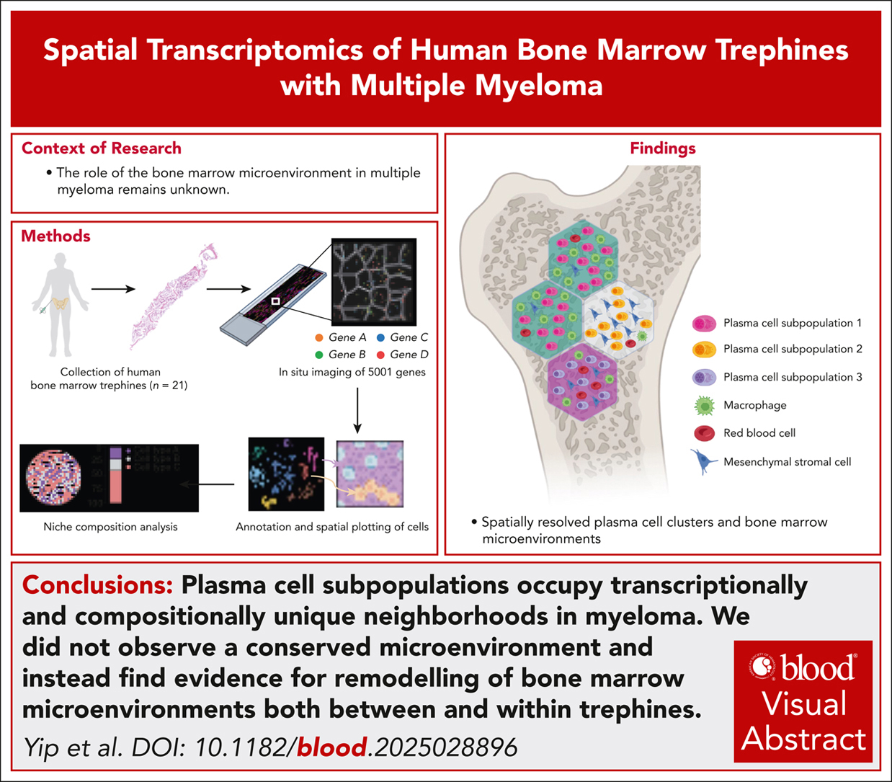

# Spatial transcriptomics of human bone marrow trephines with multiple myeloma

This repository contains the code to reproduce the analysis in the following paper: 
 
**Profiling the spatial architecture of multiple myeloma in human bone marrow trephine biopsy specimens with spatial transcriptomics** 
 
Raymond K. H. Yip\*, Jeremy Er\*, Lei Qin, Quoc Hoang Nguyen, Allan Motyer, Joel S. Rimes, Amanda Light, Ruvimbo D. Mishi, Ling Ling, Casey J. A. Anttila, Ellen Tsui, Daniela Amann-Zalcenstein, Mark R. Dowling, Kelly L. Rogers&dagger;, Rory Bowden&dagger;, Yunshun Chen&dagger;, Simon J. Harrison&dagger; and Edwin D. Hawkins&dagger; 
 
*Blood* 2025;146(15):1837–1849. doi:[10.1182/blood.2025028896](https://doi.org/10.1182/blood.2025028896) 
\*These authors contributed equally. 
&dagger;These authors jointly supervised this work.

  

## Data

* Raw Xenium output of the 21 Xenium Prime 5K bone marrow trephines and the RM-1 pilot: GEO [GSE299193](https://www.ncbi.nlm.nih.gov/geo/query/acc.cgi?acc=GSE299193) (SuperSeries [GSE299207](https://www.ncbi.nlm.nih.gov/geo/query/acc.cgi?acc=GSE299207)).
* Processed data objects, result tables and the numbers plotted in each figure panel: Zenodo [TODO: DOI].

## Analyses

**Detailed setup and analysis instructions are provided in the respective subfolders:**
1) [`Xenium_analysis/`](./Xenium_analysis): from the GEO files to the processed objects (per-sample analysis, pseudo-bulk DE, integration of plasma and stromal cells, pilot data sets).
2) [`Figures/`](./Figures): figure panels regenerated from the Zenodo objects.

[`annotation/`](./annotation) contains the sample sheet with the per-sample analysis parameters, the per-sample cluster annotation, the cell type colours and the NCBI gene annotation used by both.

## License

GPL-3; see [`LICENSE`](LICENSE).
